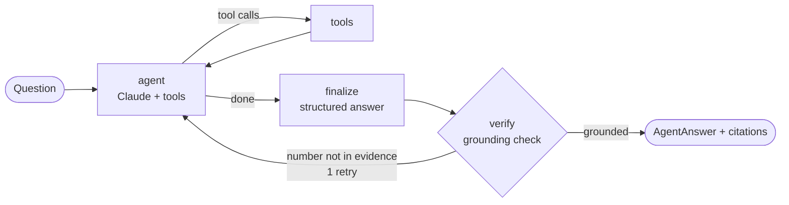

# EDGAR Filings Analyst

A LangGraph agent that answers questions about US public companies **from their SEC 10-K
filings**, with a golden-dataset evaluation that measures how much retrieval actually beats
the same model answering from memory.

> "What was Home Depot's revenue in fiscal 2024?" sounds easy. A model answering from memory
> has to know that Home Depot's fiscal 2024 ended in **February 2025**, that the 10-K reports
> figures in millions, and which of several revenue tags is the headline number. It also has
> to remember the number exactly. This project measures how often it gets all of that right,
> and how much a retrieval agent with exact-figure tools improves on it.
>
> **Result: 99% accuracy for the agent vs. 47% for the same model answering from memory, and
> 100% vs. 18% on small-cap companies.**

## Why EDGAR

- **Precision:** answers are exact numbers, so they can be graded automatically. A model that
  "roughly knows" a company's financials still gets graded wrong.
- **Freshness and long tail:** new filings arrive every quarter, after any model's training
  cutoff, and smaller companies are barely memorized at all.
- **Real retrieval problems:** 300-page documents, financial tables, prior-year comparatives that
  look like current figures, and companies with non-calendar fiscal years.

## How it works



**Tools**

| Tool | What it does |
| --- | --- |
| `get_financial_metric` | Exact annual figure from the SEC's XBRL data (revenue, net income, assets, cash flow, EPS…), resolved to the company's own fiscal-year label |
| `list_fiscal_years` | The fiscal years on file and the date each one ended, so the agent can resolve "fiscal 2024" correctly |
| `search_filings` | Semantic search over 10-K text, filterable by ticker, fiscal year and Item (MD&A, Risk Factors…) |
| `calculate` | Safe arithmetic (an AST evaluator, not `eval`), so margins and growth rates are never mental math |

**Guardrails**

- **Structured output:** every answer is a Pydantic `AgentAnswer` with a value, unit, period end
  date and citations to an XBRL concept, a 10-K Item, or a calculation.
- **Deterministic grounding check:** the `verify` node rejects any headline number that doesn't
  appear in a tool result (allowing for "in millions" scaling) and sends the agent back once
  with feedback. This catches a model that retrieves the right document and then reports a
  remembered number anyway.

**Ingestion:** `sec_client.py` downloads filings politely (required User-Agent, under the
SEC's 10 requests/second limit, with a disk cache). `parse_10k.py` strips the hidden inline-XBRL
data, flattens tables into `label | value | value` rows, and splits the document by Item. It keeps
the longest match for each heading, which skips the table of contents. Chunks are embedded
locally with `BAAI/bge-small-en-v1.5` into Chroma, with ticker, fiscal year and Item metadata.

## Evaluation

`eval/build_golden.py` builds the golden dataset from the companies' own XBRL-tagged
figures. Derived answers (margins, growth) are computed in Python, never by an LLM.

| Type | Example | Graded as |
| --- | --- | --- |
| `lookup` | Total revenue / net income / total assets / operating cash flow for fiscal year N | within ±0.5% |
| `derived` | Gross margin, net margin, year-over-year revenue growth | within ±0.3 percentage points |
| `fiscal_calendar` | "In which calendar month did fiscal year N end?" | exact month |

`eval/run_eval.py` runs every question through **(a) the agent** and **(b) a no-retrieval
baseline**: the same model and output schema, answering from memory. It reports accuracy by
question type and by **market-cap tier**, plus grounding rate, tool calls and latency.

The 20 default companies fall into four tiers by approximate market capitalization when they
were picked: mega ($200B+), large, mid and small (~$300M–2B). The hypothesis: a model's memory
is good for the most-discussed companies and degrades down the tiers, so retrieval matters
most for the long tail. Tiers are labels for the eval, not live data, and will drift as
stock prices move.

### Results

Run on 2026-10-26 with `claude-sonnet-5-5` on the 149 golden questions in
[`eval/golden.jsonl`](eval/golden.jsonl) across 20 companies. Raw per-question results:
[`results/run_20261026_122513.jsonl`](results/run_20261026_122513.jsonl). Re-print these tables
without calling any models: `uv run python eval/run_eval.py --summarize results/run_20261026_122513.jsonl`.

| Question type | Agent | Baseline (no retrieval) |
| --- | --- | --- |
| lookup | 75/75 (100%) | 25/75 (33%) |
| derived | 54/55 (98%) | 28/55 (51%) |
| fiscal_calendar | 19/19 (100%) | 17/19 (89%) |
| **All** | **148/149 (99%)** | **70/149 (47%)** |

| Market-cap tier | Agent | Baseline (no retrieval) |
| --- | --- | --- |
| mega | 40/40 (100%) | 33/40 (82%) |
| large | 39/39 (100%) | 22/39 (56%) |
| mid | 29/30 (97%) | 8/30 (27%) |
| small | 40/40 (100%) | 7/40 (18%) |

- **The less famous the company, the more retrieval matters.** The baseline falls from 82% on
  mega-caps to 18% on small-caps. The agent holds at 97–100% in every tier.
- **Even the best-known companies have a freshness gap.** The baseline couldn't answer
  Microsoft's fiscal 2026 revenue (a 10-K filed after the model's training cutoff); the agent
  answered it from the filing.
- **Exact figures are where memory fails most.** The baseline got 33% of dollar-amount lookups
  right. It does better on ratios (51%), which tolerate approximate inputs.
- **Every agent answer passed the grounding check** (149/149), averaging 2.7 tool calls.
- **The cost is latency:** 6.4 s per answer for the agent vs. 4.1 s for the baseline.

See the caveats below before reading too much into the agent's near-perfect lookup score.

### Caveats

- Ground truth for `lookup` questions comes from the same XBRL data the agent's
  `get_financial_metric` tool reads. That is deliberate: the eval measures whether the agent
  *uses* authoritative data correctly (picks the right company, fiscal year, metric and units,
  and computes derived figures correctly), compared with a model answering from memory. It is
  not an independent audit of the SEC data itself.
- Companies tag some figures inconsistently (for example, revenue under different XBRL
  concepts). The lookup tries candidate tags in priority order and falls back to text search.
- The grounding check matches numbers, not meaning. It can be fooled by a coincidental match
  in retrieved text. It is a cheap first line of defense, not proof of correctness.

## Quickstart

Requires Python 3.11+ and [uv](https://docs.astral.sh/uv/).

```bash
cp .env.example .env          # add ANTHROPIC_API_KEY and SEC_USER_AGENT ("Name email@example.com")
uv sync

# 1. Download and index 3 years of 10-Ks for the 20 default companies (~20 minutes the first time)
uv run python -m edgar_agent.ingest --years 3

# 2. Ask a question
uv run python -m edgar_agent.ask "What was Home Depot's gross margin in fiscal 2024?"

# 3. Build the golden set and run the eval
uv run python eval/build_golden.py
uv run python eval/run_eval.py --limit 10     # smoke test
uv run python eval/run_eval.py                # full run, agent vs. baseline
uv run python eval/run_eval.py --tiers mid small   # only some market-cap tiers

# Unit tests (parsing, XBRL lookup, grounding, grading)
uv run pytest
```

Set `LANGSMITH_TRACING=true` and `LANGSMITH_API_KEY` in `.env` to trace every agent run in
LangSmith.

### Model providers

The agent runs on **Anthropic** (default) or **Azure OpenAI**, selected with one setting:

```bash
# .env
LLM_PROVIDER=azure_openai
AZURE_OPENAI_ENDPOINT=https://<your-resource>.openai.azure.com/
AZURE_OPENAI_API_KEY=...
AZURE_OPENAI_DEPLOYMENT=<your deployment name>
OPENAI_API_VERSION=2024-10-21
```

The graph, tools, grounding check and eval are identical across providers, so the same golden
set compares models directly. A cheap check of a new provider:

```bash
uv run python -m edgar_agent.ask "What was Toro's revenue in fiscal 2024?"
uv run python eval/run_eval.py --systems agent --limit 10
```

### Run as an API

```bash
uv run uvicorn edgar_agent.api:app --port 8000
curl localhost:8000/readyz
curl -X POST localhost:8000/ask -H 'content-type: application/json' \
  -d '{"question": "What was Toro'"'"'s revenue in fiscal 2024?"}'
```

| Endpoint | Purpose |
| --- | --- |
| `POST /ask` | Structured answer, citations, grounding result, tool-call count, latency |
| `GET /healthz` | Liveness: the process is up |
| `GET /readyz` | Readiness: 503 until ingest has built the vector index and SEC cache |
| `GET /metrics` | Prometheus metrics: request outcomes, latency, grounded vs. ungrounded answers, tool calls, provider |

### Run in Docker

```bash
docker build -t edgar-analyst:dev .
docker image ls edgar-analyst:dev          # CPU-only PyTorch keeps this to a few GB

# Serve the API against your existing data/ folder
docker run --rm -p 8000:8000 --env-file .env \
  --user "$(id -u):$(id -g)" -v "$PWD/data:/data" edgar-analyst:dev

# The same image runs ingest
docker run --rm --env-file .env --user "$(id -u):$(id -g)" -v "$PWD/data:/data" \
  edgar-analyst:dev python -m edgar_agent.ingest --years 3
```

`--user` lets the container write to your `data/` folder (the image's own user is a
non-root `app` user). `docker run --env-file` doesn't strip quotes, so write `.env` values
without them.

### Run as a server (LangGraph Studio)

```bash
uv run langgraph dev
```

This serves the graph over HTTP (configured in `langgraph.json`) and opens LangGraph Studio,
where you can send a question and watch it move through agent → tools → finalize → verify.
Input: `{"messages": [{"role": "user", "content": "What was Toro's revenue in fiscal 2024?"}]}`.

The same config works with `langgraph up` (Docker) or LangSmith Deployment. Those
environments need the `data/` directory (Chroma index and SEC cache) made available to the
container, or a fresh ingest run inside it.

## Layout

```
src/edgar_agent/
  sec_client.py   EDGAR client: User-Agent, rate limit, disk cache
  parse_10k.py    10-K HTML -> clean text -> Item sections
  xbrl.py         fiscal-year-aware exact figures from companyfacts JSON
  ingest.py       download, chunk, embed into Chroma
  tools.py        agent tools
  graph.py        LangGraph workflow (agent -> tools -> finalize -> verify)
  llm.py          chat model factory (Anthropic or Azure OpenAI)
  server.py       graph entry point for LangGraph Server (langgraph.json)
  api.py          FastAPI service: /ask, health probes, Prometheus metrics
  grounding.py    deterministic number-in-evidence check
  schemas.py      AgentAnswer / Citation (Pydantic)
  baseline.py     no-retrieval control
  grading.py      golden-answer grading
eval/
  build_golden.py golden dataset from XBRL ground truth
  run_eval.py     agent vs. baseline runner and report
tests/            unit tests with fixture 10-K HTML and companyfacts JSON
```

## Roadmap

The next phase (FastAPI service, Kubernetes, multicloud model providers, Terraform on Azure) is planned step by step in [`docs/PLATFORM_ROADMAP.md`](docs/PLATFORM_ROADMAP.md).


- Text questions ("why did gross margin change?") graded against hand-written key facts with an LLM judge
- Hybrid retrieval (BM25 + embeddings) and reranking for table-heavy passages
- 10-Q and 8-K ingestion to test freshness on events after a model's training cutoff
